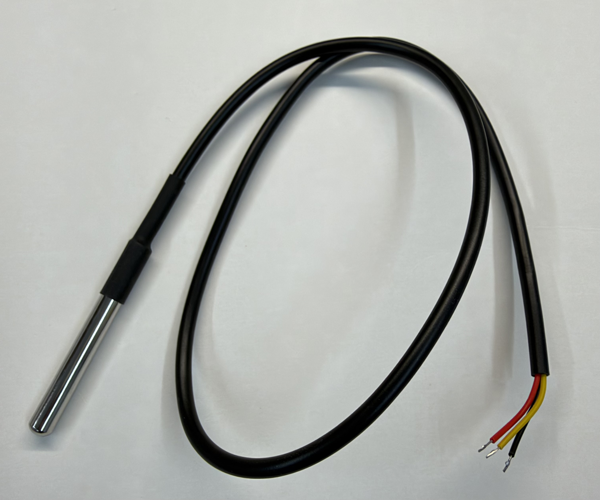
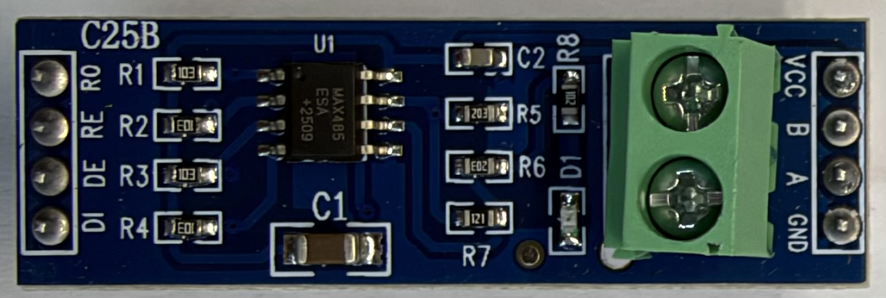
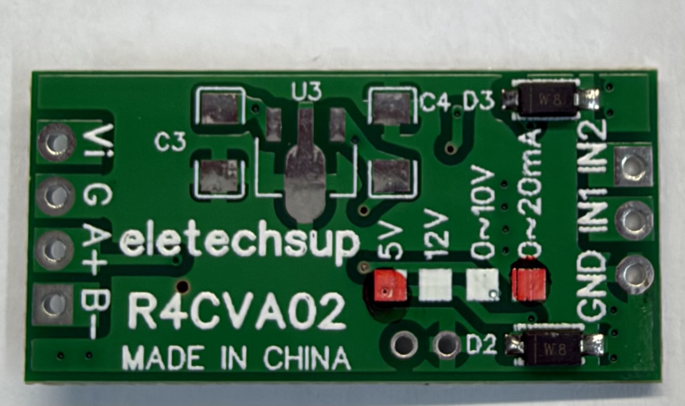
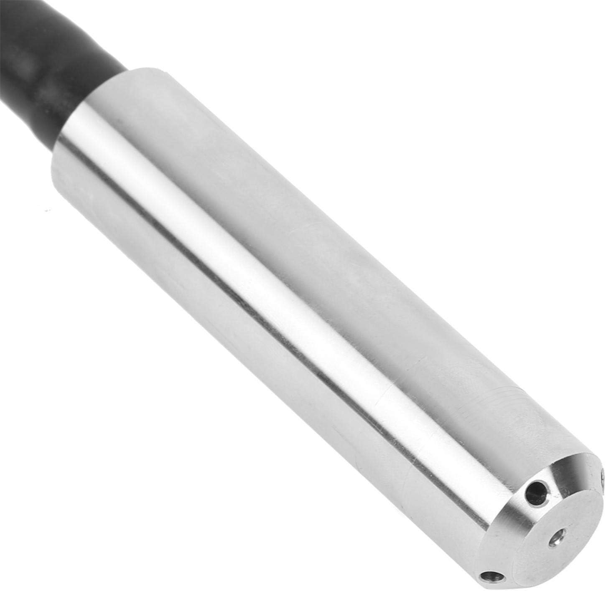
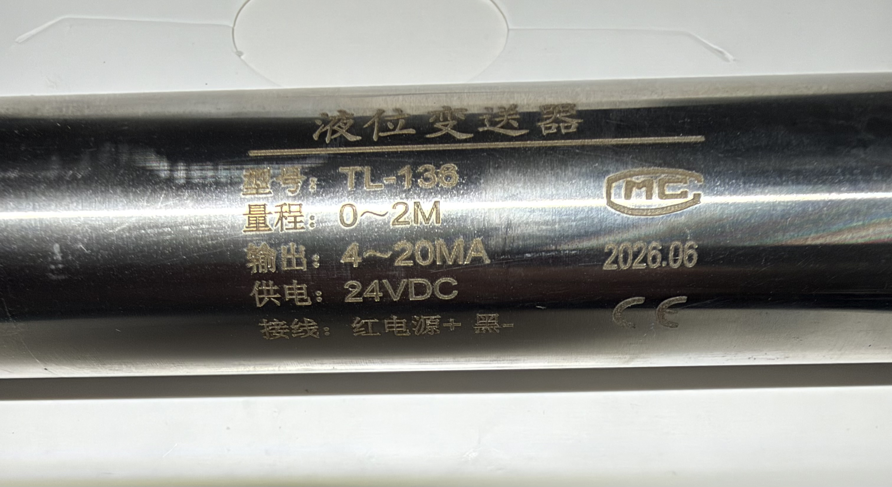
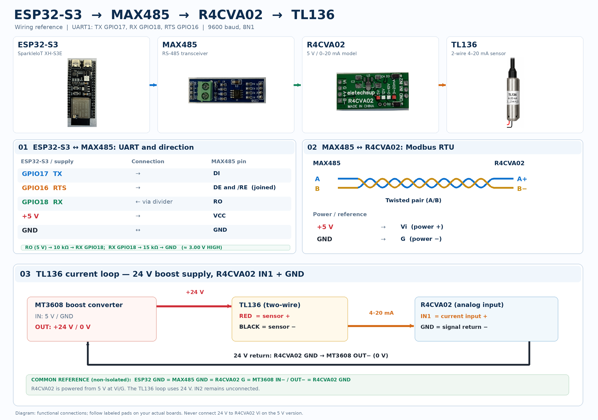

# Hardware Setup

This document describes the hardware used for the ESP32 AWS IoT Capstone project.

The firmware was developed and tested with an ESP32-S3 N16R8 development board and BME280, DS18B20, and TL136 sensors. The sensors use I2C, 1-Wire, and Modbus RTU/RS-485 interfaces respectively.

## 1. Folder structure

The hardware documentation uses the following folder structure:

```text
docs/
├── HARDWARE.md
└── images/
    ├── DS18B20.jpeg
    ├── Eletechsup_R4CVA02_5V_20mA.jpeg
    ├── MAX485_C25B_RS485.jpeg
    ├── TL136_leaflet_overview.jpeg
    ├── TL136_leaflet_specifications.jpeg
    ├── TL136_nameplate.jpeg
    ├── TL136_sensor.jpg
    ├── bme280_board.jpg
    ├── esp32_max485_r4cva02_tl136_wiring.png
    ├── esp32s3_board.jpg
    └── esp32s3-bme280-wiring.jpg
```

## 2. ESP32-S3 board


The board used for development is an ESP32-S3 N16R8 development board with:

- ESP32-S3 module
- 16 MB flash
- 8 MB PSRAM
- USB-C connectors
- CH343 USB-to-serial interface
- integrated RGB LED

## 3. BME280 sensor

### 3.1 BME280 sensor board


The schematic illustrates the breakout's internal circuitry, particularly its onboard I2C pull-up resistors. For external wiring, follow the printed `VIN`, `GND`, `SCL`, and `SDA` labels on the breakout rather than interpreting the schematic as a physical connector layout.

The BME280 breakout exposes four pins used by this project:

| Pin | Function |
|---|---|
| VIN | Sensor supply input |
| GND | Ground |
| SCL | I2C clock |
| SDA | I2C data |

The breakout used in this project already includes pull-up resistors:

- R3/R4 = 10 kΩ pull-ups on the host-side lines ASCL/ASDA to VIN
- R5/R6 = 10 kΩ pull-ups on the sensor-side lines BSCL/BSDA to BVCC (3.3 V)

Therefore, no additional external I2C pull-up resistors were added for this breadboard setup.

### 3.2 BME280 wiring


| BME280 pin | ESP32-S3 pin | Function |
|---|---|---|
| VIN | 3V3 | 3.3 V power |
| GND | GND | Ground |
| SCL | GPIO4 | I2C clock |
| SDA | GPIO5 | I2C data |

BME280 I2C address: 0x76

## 4. DS18B20 sensor

### 4.1 DS18B20 encapsulated probe



The sensor used in this project is a DS18B20 digital thermometer enclosed in a metal probe with a three-wire cable. It communicates over a 1-Wire bus and is powered from the ESP32-S3's 3.3 V supply.

#### Technical data

| Property | Value |
|---|---|
| Sensor / interface | DS18B20 / digital 1-Wire |
| IC supply range | 3.0–5.5 V DC; project supply: 3.3 V |
| IC temperature range | −55 to +125 °C |
| IC accuracy | ±0.5 °C from −10 to +85 °C |
| Resolution | 9–12 bit; firmware uses 12 bit |
| Temperature step at 12 bit | 0.0625 °C |
| Conversion time at 12 bit | Up to 750 ms |
| Device identification | Unique 64-bit ROM code |

The temperature and accuracy specifications above apply to the DS18B20 IC. The assembled probe's cable temperature limits and ingress-protection rating have not been verified.

#### Sealing the metal-to-cable transition

For improved water sealing, add an extra length of **adhesive-lined heat-shrink tubing** over the metal-to-cable transition. Overlap both the metal probe and the intact cable jacket, then shrink the tubing so its internal adhesive forms a continuous seal at both ends. Keep the stripped cable end and electrical connections dry. This improves the transition seal without establishing a tested IP rating for the complete assembly.

### 4.2 DS18B20 wiring

| Probe wire | DS18B20 function | ESP32-S3 connection |
|---|---|---|
| Red | `VDD` | `3V3` |
| Yellow | `DQ` — 1-Wire data | GPIO15 |
| Black | `GND` | GND |

Add an external **4.7 kΩ pull-up resistor** between GPIO15 / `DQ` and `3V3`:

```text
3V3    ──┬────────────────── red / VDD
         │
       4.7 kΩ
         │
GPIO15 ──┴────────────────── yellow / DQ
GND    ───────────────────── black / GND
```

Use the board's `3V3` pin for both the sensor supply and the data-line pull-up. The wiring shown uses external power through `VDD`. The firmware disables the bus's internal pull-up, so the external resistor is required.

GPIO15 is the build-time default under **Application Configuration > 1-Wire Bus**. Enable the DS18B20 and configure its matching 64-bit ROM address on the HTTPS configuration page. The default sampling interval is 5000 ms.

## 5. TL136 sensor

The TL136 water-level sensor is connected through an R4CVA02 analog-input converter and a MAX485 RS-485 transceiver. The current setup uses an MT3608 boost converter to supply the sensor's 24 V current loop.

### 5.1 MAX485 RS-485 transceiver board



The C25B module is a 5 V, half-duplex RS-485/RS-422 transceiver board based on a MAX485ESA. It converts the ESP32-S3 UART transmit and receive signals to the differential two-wire RS-485 bus used by the R4CVA02.

#### Technical data

| Property | Value |
|---|---|
| Transceiver | MAX485ESA |
| Interface | Two-wire RS-485/RS-422, half duplex |
| Supply voltage | 5 V DC |
| Maximum data rate | 2.5 Mbit/s |
| Project data rate | 9600 baud, 8N1 |
| Direction control | External through `/RE` and `DE` (UART RTS) |
| Bus termination | 120 Ω onboard resistor `R7`, marked `121` |

The ESP32-S3's 3.3 V output level satisfies the MAX485's logic-high input requirement. The receiver output `RO` is a 5 V-domain output whose high level can approach `VCC` and must not be connected directly to an ESP32-S3 input.

#### Connections

| Pin | Function |
|---|---|
| `RO` | Receiver output |
| `/RE` | Receiver enable; active low |
| `DE` | Driver enable; active high |
| `DI` | Driver input |
| `VCC` | Positive 5 V module supply |
| `B` | Inverting RS-485 bus line |
| `A` | Non-inverting RS-485 bus line |
| `GND` | Ground |

#### ESP32-S3 connection used in this project

```text
ESP32-S3 GPIO17 (UART TX) -> MAX485 DI
ESP32-S3 GPIO16 (UART RTS) -> MAX485 /RE and DE joined together
MAX485 RO -> 10 kΩ -> ESP32-S3 GPIO18 (UART RX)
ESP32-S3 GPIO18 -> 15 kΩ -> GND
+5 V -> MAX485 VCC
GND -> MAX485 GND
MAX485 A/B -> R4CVA02 A+/B-
```

With `/RE` and `DE` joined, RTS low selects receive mode and RTS high selects transmit mode. The 10 kΩ/15 kΩ divider scales the `RO` voltage by 0.6, giving a nominal 3.0 V at GPIO18 when `RO` is 5.0 V. The actual high level depends on the `RO` output voltage.

> **Note:** This module requires external direction control. In this project, the ESP-IDF UART driver automatically switches RTS in RS-485 half-duplex mode.

### 5.2 R4CVA02 analog-input converter board



The Eletechsup R4CVA02 is a compact two-channel current-measurement module with an RS-485/Modbus RTU interface. This project uses the 5 V, 0/4–20 mA variant `R4CVA02_20MA_5V`, identified by the red variant markers beside `5V` and `0~20mA`.

#### Technical data

| Property | Value |
|---|---|
| Supply voltage | 4–5.5 V DC; typically 5 V |
| Supply current | Approximately 9–13 mA |
| Input channels | 2 current inputs |
| Measurement range | 0–21 mA |
| Resolution | 0.01 mA |
| Measurement accuracy | Approximately ±0.5% according to the manufacturer |
| ADC resolution | 12 bit |
| Modbus read functions | 03 and 04 |
| Modbus write functions | 06 and 16 |

#### Connections

| Pin | Function |
|---|---|
| `Vi` | Positive 5 V module supply |
| `G` | Module supply ground |
| `A+` | RS-485 A |
| `B-` | RS-485 B |
| `IN1` | Current input channel 1 |
| `IN2` | Current input channel 2 |
| `GND` | Analog-signal return |

#### TL136 connection used in this project

The TL136 is a two-wire 4–20 mA sensor connected to the first current-input channel:

```text
24 V+       -> TL136 red wire
TL136 black -> R4CVA02 IN1
24 V-       -> R4CVA02 GND
```

The 24 V current-loop return and the 5 V module supply use a common ground in this non-isolated setup. The measured input burden is 139.5 Ω, corresponding to approximately 2.79 V at 20 mA.

> **Warning:** Never connect 24 V directly to `IN1` or to the 5 V module supply input `Vi`.

### 5.3 TL136 sensor

Submersible level transmitter · two-wire 4–20 mA loop

| Probe | Actual laser marking |
|---|---|
|  |  |

#### Verified on the sensor

| Property | Value |
|---|---|
| Measuring range | 0–2 m water head |
| Output | 4–20 mA, two-wire |
| Supply | 24 V DC, as marked on the body |
| Wire colors | Red = positive supply; black = current-loop output |
| Body marking | TL-136 / 2026.06 |

#### Vendor leaflet — general series data

The supplied *ALS-MPM-2F* leaflet describes an IP68 transmitter with a stainless-steel body, a vented cable, and a standard accuracy of 0.25% of full scale. These series specifications have not been independently verified for the installed TL-136; use its body markings for the range, supply, and output variant.

#### Two-wire loop used in this project

```text
MT3608 +24 V ── red ──> TL-136 ── black ──> R4CVA02 IN1
MT3608 VOUT− <───────────────────────────── R4CVA02 GND
```

The R4CVA02 is powered separately from 5 V. Its supply ground and signal `GND` share a common reference with the MT3608 output negative, as shown in section 5.4.

#### Current to level — nominal 0–2 m

With the firmware's default full-scale setting of `2000` mm:

```text
h [mm] = (I [mA] - 4) × 125
```

| 4 mA | 12 mA | 20 mA |
|---|---|---|
| 0 mm | 1000 mm | 2000 mm |

#### Setup notes

- Connect the black wire to `IN1`; it carries the loop signal and must not be connected directly to ground.
- Set and verify the MT3608 output at 24.0 V before connecting the sensor.
- Keep any cable vent path open to atmospheric pressure, if present.
- Check the zero and full-scale readings. The firmware provides converter-gain and full-scale range settings.

### 5.4 ESP32-S3, MAX485, R4CVA02, and TL136 wiring



The diagram documents the verified UART, RS-485, power, and 4–20 mA current-loop connections. It also shows the voltage divider used between the MAX485's 5 V-domain receiver output and ESP32-S3 GPIO18.

The illustrated circuit is non-isolated and uses a common ground reference. The 24 V sensor supply must not be connected to the 5 V `Vi` input of the R4CVA02 version shown.

## 6. ESP-IDF configuration relevance

The project is configured for ESP32-S3 and uses the following hardware-related settings:

- ESP32-S3 target
- 16 MB flash
- custom OTA-capable partition table
- octal PSRAM enabled
- I2C bus configured for the BME280 sensor
- 1-Wire bus configured for the DS18B20 sensor
- UART and Modbus RTU configured for the MAX485/R4CVA02/TL136 chain

The persistent project defaults are stored in `sdkconfig.defaults`.

## 7. References

- Bosch Sensortec BME280 Datasheet:  
  https://www.bosch-sensortec.com/media/boschsensortec/downloads/datasheets/bst-bme280-ds002.pdf

- Espressif ESP32-S3 Series Datasheet:  
  https://documentation.espressif.com/esp32-s3_datasheet_en.pdf

- [Eletechsup R4CVA02 product page and specifications](https://eletechsup.com/products/r4cva02-mini-2ch-modbus-rtu-rs485-a-d-converter-for-4-20ma-0-5v-0-10v-input-signal-4-25vdc-r4cva02)

- [Eletechsup R4CVA02/R4IVB02 Modbus RTU command manual](https://1drv.ms/u/s!Av4PLxH_z8f1gYoM-07qUMBmVmVekg?e=hTfGxl)

- [Analog Devices MAX485 product page](https://www.analog.com/en/products/max485.html)

- [Analog Devices MAX481/MAX483/MAX485/MAX487–MAX491/MAX1487 datasheet](https://www.analog.com/media/en/technical-documentation/data-sheets/MAX1487-MAX491.pdf)

- [Analog Devices DS18B20 Programmable Resolution 1-Wire Digital Thermometer datasheet](https://www.analog.com/media/en/technical-documentation/data-sheets/DS18B20.pdf)

- Installed encapsulated DS18B20 probe: [project photograph](./images/DS18B20.jpeg). Wiring follows the supplied *DS18B20 — Encapsulated 1-Wire temperature probe* component reference.

- Installed TL-136 identification and ratings: [sensor nameplate](./images/TL136_nameplate.jpeg).

- Supplied *ALS-MPM-2F Water level transmitter datasheet*, headed Taizhou Allison Instruments Co., Ltd.: [description page](./images/TL136_leaflet_overview.jpeg) and [specifications and wiring page](./images/TL136_leaflet_specifications.jpeg). This leaflet covers a transmitter family; the installed unit is marked TL-136.
