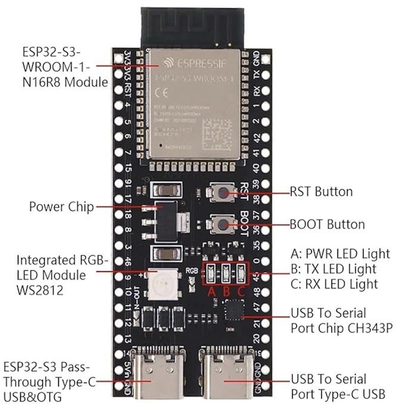
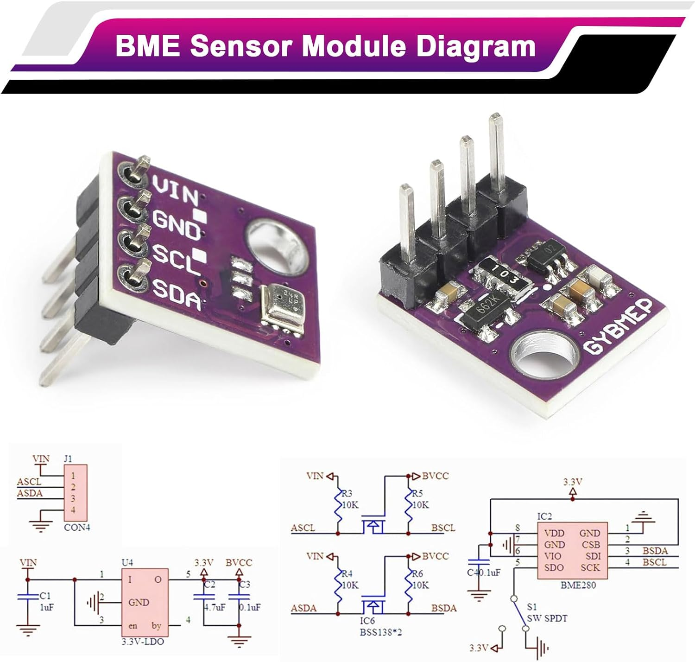
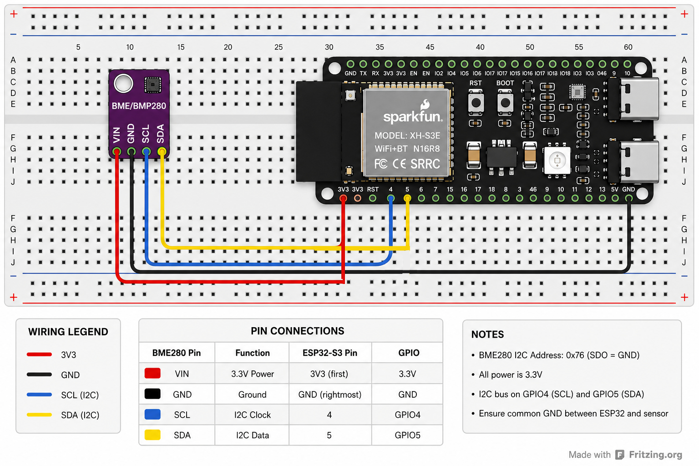

# Hardware Setup

This document describes the hardware used for the ESP32 AWS IoT Capstone project.

The firmware was developed and tested with an ESP32-S3 N16R8 development board and a BME280 sensor breakout connected via I2C.

## 1. Folder structure

The hardware documentation uses the following folder structure:

```text
docs/
├── HARDWARE.md
└── images/
    ├── bme280_board.jpg
    ├── esp32s3_board.jpg
    └── esp32s3-bme280-wiring.jpg
```

## 2. ESP32-S3 board



The board used for development is an ESP32-S3 N16R8 development board with:

- ESP32-S3 module
- 16 MB flash
- 8 MB PSRAM
- USB-C connectors
- CH343 USB-to-serial interface
- integrated RGB LED

## 3. BME280 sensor board



The BME280 breakout exposes four pins used by this project:

| Pin | Function |
|---|---|
| VIN | Sensor supply input |
| GND | Ground |
| SCL | I2C clock |
| SDA | I2C data |

The breakout used in this project already includes pull-up resistors:

- R3/R4 = 10 kΩ pull-ups on the host-side lines ASCL/ASDA to VIN
- R5/R6 = 10 kΩ pull-ups on the sensor-side lines BSCL/BSDA to BVCC (3.3 V)

Therefore, no additional external I2C pull-up resistors were added for this breadboard setup.

## 4. Wiring



| BME280 pin | ESP32-S3 pin | Function |
|---|---|---|
| VIN | 3V3 | 3.3 V power |
| GND | GND | Ground |
| SCL | GPIO4 | I2C clock |
| SDA | GPIO5 | I2C data |

BME280 I2C address: 0x76

## 5. ESP-IDF configuration relevance

The project is configured for ESP32-S3 and uses the following hardware-related settings:

- ESP32-S3 target
- 16 MB flash
- custom OTA-capable partition table
- octal PSRAM enabled
- I2C bus configured for the BME280 sensor

The persistent project defaults are stored in `sdkconfig.defaults`.

## 6. References

- Bosch Sensortec BME280 Datasheet:  
  https://www.bosch-sensortec.com/media/boschsensortec/downloads/datasheets/bst-bme280-ds002.pdf

- Espressif ESP32-S3 Series Datasheet:  
  https://documentation.espressif.com/esp32-s3_datasheet_en.pdf